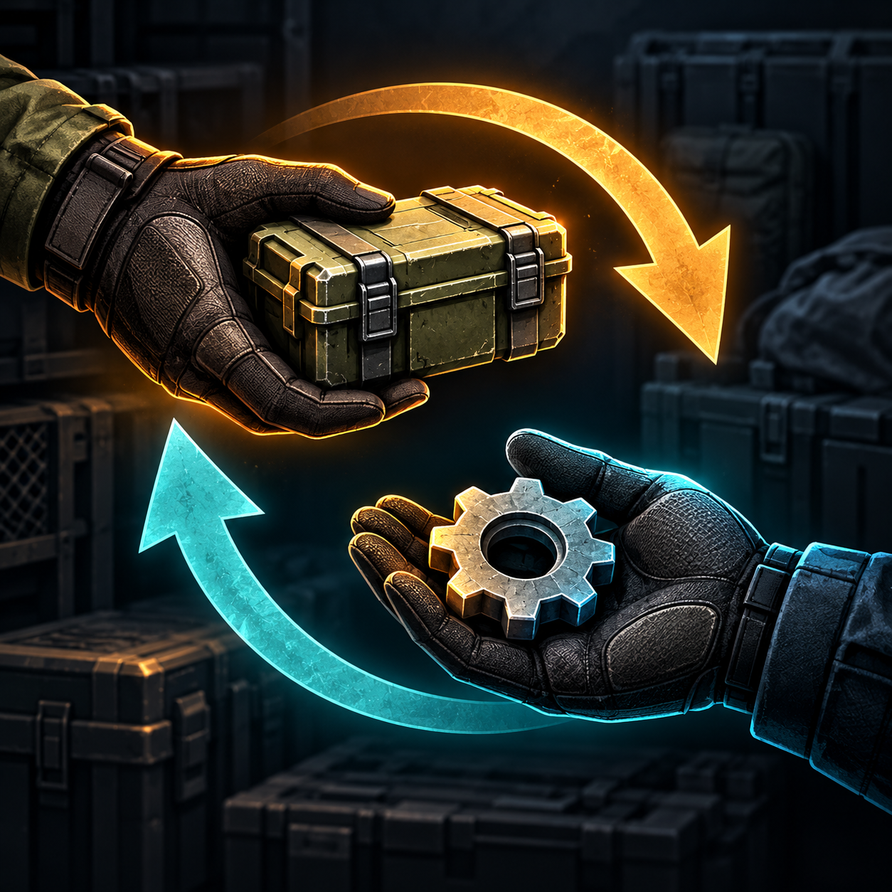

# SPT Barterizer



A server mod for **SPT 4.1.6** that turns cash offers into ordinary item barters. Designed to complement [OpenBarters](https://github.com/forcedroidbrain/OpenBarters/tree/feature/partial-barter-price-multiplier) and [HardcoreRules](https://github.com/dwesterwick/SPTHardcoreRules).

Version **0.2.0**. Built against SPT 4.1.6. Automated checks cover the SPT database at default settings and with barter variety enabled, and the installed HardcoreRules 3.1.0 DLL. Runtime server loading and in-game purchasing have not yet been verified for this version.

## Behavior

- Converts offers paid entirely in RUB, USD or EUR, including multiple cash alternatives.
- Preserves every offer that already contains an item barter, including mixed cash/item recipes and offers with both cash and barter alternatives.
- Keeps original offer IDs, items and attachments, loyalty levels, quest mappings, stock, purchase limits and purchase counters.
- Does not modify saved inventories or database files on disk. Uninstalling and restarting restores the source cash recipes.
- Uses a stable seed, trader ID, offer ID and alternative index. Recipes stay the same across restocks and restarts with the same configuration and payment pool.
- Prevents the item being sold, and its attached items, from becoming their own payment ingredients.

**Loose ammunition stays a cash offer.** HardcoreRules can hide it as usual. **Factory ammunition boxes are eligible for conversion**; existing ammunition-box barters stay unchanged. This distinction uses the Ammo and AmmoBox template categories, not price or stack size.

Fence and Lightkeeper, currency exchanges, quest items and special-item categories are excluded by default. Other custom traders use the same rules as vanilla traders.

## Pricing and OpenBarters

The target recipe value is the original cash cost converted to roubles using handbook currency rates, multiplied by `priceMultiplier` (default **1.0**). Payment items come from barter loot, food and drinks and are valued at handbook prices.

The generator uses positive, whole item counts. Recipe value meets or exceeds the target; integer rounding can make cheap offers noticeably more expensive. It tries a varied recipe, then falls back to a valid bounded recipe if random choices cannot finish it. If the pool or configured limits cannot represent a price, the original cash offer is left unchanged and a warning is logged.

For more variety, set `recipeValueTolerancePercent` to e.g. `25` and restart the server. When finishing a recipe, the generator randomly chooses among options whose complete recipe value is within 25% above the cheapest valid completion, including ingredients already selected. For example, if the cheapest completion makes a 1000-rouble recipe, alternatives up to 1250 roubles are eligible. This also applies to single-item fallback recipes; the multi-item capacity fallback is unchanged. Values use handbook prices, not market or trader resale prices. The tolerance is relative to the cheapest completion at that step, not the original cash cost or a globally optimal recipe; rounding can already make that completion exceed the cash target. Variety requires multiple eligible options and is not guaranteed for every offer. The same seed, configuration, offer IDs and payment pool still produce the same recipes. `0` (or an omitted setting) preserves the previous recipes exactly.

The server does not apply OpenBarters' substitute surcharge. With our OpenBarters branch, bringing the requested ingredients closes their part of the recipe at full credit; only the missing part gets its F12 multiplier (default **1.5**). The effective cost of substitutes also depends on the trader's sell-tab prices.

Stock OpenBarters can also recognize generated recipes as ordinary barters, but it does not have the partial-substitution pricing added in our branch. OpenBarters itself is optional: the generated recipes can be paid normally.

## HardcoreRules integration

HardcoreRules is optional and is detected at runtime without a build dependency.

- When `preserveHardcoreWhitelistedOffers` is true, its item/category and trader whitelist entries are left unchanged. This preserves the configured cash medicine and special-item exceptions.
- Conversion runs **before** `TraderOffersUtil.RemoveBannedTraderOffers`, so its snapshot and cash filter see completed barters.
- Conversion is also checked after `RestoreTraderOffers`, before trader assortments are served, and after restocks. This covers restored snapshots and later cash offers added by other mods.
- HardcoreRules' remaining restrictions continue to apply. In particular, `whitelist_only: true` still hides offers outside its whitelist. Barterizer does not override that restriction or revive removed offers.
- Recipes apply to all profiles on the server. Toggling HardcoreRules off restores its cached assortment with converted recipes; it does not turn Barterizer off.

The compatibility check uses the actual installed HardcoreRules 3.1.0 cache/filter/restore code for two complete cycles. Other HardcoreRules versions require verification; a detected incompatible API fails visibly rather than silently skipping integration.

## Installation

1. Close the SPT server.
2. Extract `SPT-Barterizer-0.2.0.zip` into the SPT root. The mod folder is `SPT_Runtime/user/mods/SPT-Barterizer/`.
3. Edit that folder's `config.json` if desired, then start the server.
4. Inspect `[Barterizer]` startup messages and `conversion-report.json` in the mod folder. Check a normal converted offer, an existing barter, a cash medicine exception, loose ammunition, and an ammunition box before continuing a playthrough.

No BepInEx plugin is included. This package does not install or replace OpenBarters or HardcoreRules, and it does not edit their configs.

When upgrading, back up your existing mod folder and keep your current `config.json` instead of replacing it with the ZIP's defaults. The new `recipeValueTolerancePercent` setting defaults to `0` when omitted. Add it with a value such as `25` to enable variety, then restart the server.

A VirusTotal scan report for the v0.2.0 DLL is pending. The v0.1.3 scan does not cover this version; obtain a new report before publishing executable content on Forge.

To uninstall, remove the Barterizer folder while the server is stopped, then restart. Do not remove purchased items from the profile.

## Configuration

Changes require a server restart.

| Setting | Default | Meaning |
| --- | --- | --- |
| `enabled` | `true` | Enable conversion and hooks |
| `seed` | `barterizer-v1` | Stable recipe seed; change it to regenerate recipes on restart |
| `priceMultiplier` | `1.0` | Base recipe cost; separate from the OpenBarters substitute multiplier |
| `recipeValueTolerancePercent` | `0` | Extra value allowed above the cheapest completion for seeded variety, range 0–100 percent; `0` preserves previous recipes |
| `maxDifferentItems` | `3` | Maximum ingredient types per recipe, range 1–5 |
| `maxCountPerItem` | `20` | Hard maximum count of each ingredient |
| `preferredMaxCountPerItem` | `5` | Prefer this count or less by choosing higher-value ingredients; relax only if the target cannot be covered within the available ingredient types and prices. Never exceeds the hard maximum |
| `minimumCashPriceRoubles` | `0` | Leave cheaper offers as cash; HardcoreRules may hide those |
| `minimumPaymentItemPrice` | `100` | Minimum eligible ingredient handbook price |
| `maximumPaymentItemPrice` | `1000000` | Maximum eligible ingredient handbook price; includes valuable loot for expensive offers such as T-7 |
| `preserveHardcoreWhitelistedOffers` | `true` | Honor the loaded HardcoreRules whitelist |
| `writeReport` | `true` | Write generated recipes and original/target/actual values to `conversion-report.json` |
| `includedTraderIds` | `[]` | Empty means all eligible traders; otherwise include only these |
| `excludedTraderIds` | Fence, Lightkeeper | Trader exclusions |
| `excludedOfferIds` | `[]` | Exclude particular offer IDs |
| `excludedSoldItemIds` | `[]` | Exclude sold item template IDs |
| `excludedSoldItemCategories` | Money, SpecialItem, Ammo | Exclude these sold-item categories and descendants |
| `paymentItemCategories` | BarterItem, Food, Drinks | Allowed payment item categories and descendants |
| `excludedPaymentItemIds` | `[]` | Never request these payment items |

## Building and verification

Requires PowerShell 7, .NET 10 SDK and a local SPT 4.1.6 installation. No NuGet packages, game DLLs or compiled dependencies are committed to this repository.

```powershell
pwsh -File tools/Build.ps1 -SptRoot 'D:\SPT4'
```

This builds the DLL, runs the test suite and packages `dist/SPT-Barterizer-0.2.0.zip`. The package version is read from the project file. It **does not deploy** to the game. The optional `-SkipTests` switch only builds and packages.

The tests exercise actual SPT models and serializers. `--spt-root` checks the real vanilla database and, when present, the installed HardcoreRules DLL. They run entirely in the test process: they do not launch the server or alter profiles, installed mods or database files. Test failures are caught and reported to the console with a nonzero exit status.

The database audit writes local reports to ignored `artifacts/`, with separate reports for default settings and 25% variety. The current local SPT 4.1.6 database audit converts **2092** cash offers in each mode, preserves **568** existing barter offers, leaves **163** loose-ammunition offers as cash and keeps **25** ammunition-box offers as barters, with no conversion failures. These are offline audit results, not live server results; installed configuration and database changes can affect the totals.

For development, `SptRoot` defaults to `D:/SPT4` and can also be passed as an MSBuild property. Tests copy runtime dependencies only to their ignored build directory.

## Related mod and attribution

[Barter Economy](https://github.com/DeadLeavez/Leaves-BarterEconomy) by DeadLeaves pursues the same idea of replacing trader cash purchases with item barters and inspired this mod's goal. SPT Barterizer is a separate C# implementation for SPT 4.1.6, not a fork or port of Barter Economy. It does not include Barter Economy code or assets. Its narrower rules preserve existing barter offers and integrate with HardcoreRules and OpenBarters as described above.

## AI assistance

OpenAI Codex was used to help develop and revise the C# code, automated tests and documentation. The cover art in `assets/forge-icon.png` was generated with OpenAI image generation. Any Forge submission must enable the **Contains AI Content** flag. The project maintainer specified the intended behavior and is responsible for reviewing and releasing the resulting mod. The mod does not call an AI service during gameplay or server operation.

## Changelog

- **0.2.0:** Added optional `recipeValueTolerancePercent` (0–100) for seeded variety among similarly priced recipe completions. The default `0`, including older configs without the setting, preserves previous recipes. Existing barters and offer restrictions remain unchanged.
- **0.1.3:** Aligned the server metadata name with Forge naming rules and expanded documentation, attribution, support and AI disclosure. Barter-generation behavior is unchanged.
- **0.1.2:** Prefer at most five of each ingredient by selecting more valuable items. Expensive offers that cannot meet this preference may use more, up to the existing hard limit.
- **0.1.1:** Exclude all dynamic dogtag templates from newly generated payment recipes. Existing dogtag barters remain unchanged.
- **0.1.0:** Initial SPT 4.1.6 cash-to-barter conversion with existing-barter preservation and optional HardcoreRules integration.

## Support

For bugs and compatibility reports, open an issue at [the project repository](https://github.com/forcedroidbrain/SPT-Barterizer/issues). Include the SPT and mod versions, relevant server-log messages and the steps to reproduce the problem. Do not post profiles or other private data.

## License

MIT. This mod does not bundle Barter Economy, HardcoreRules, OpenBarters or game assemblies. See the included `LICENSE` file.
